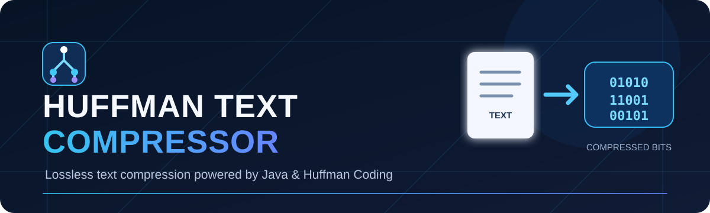
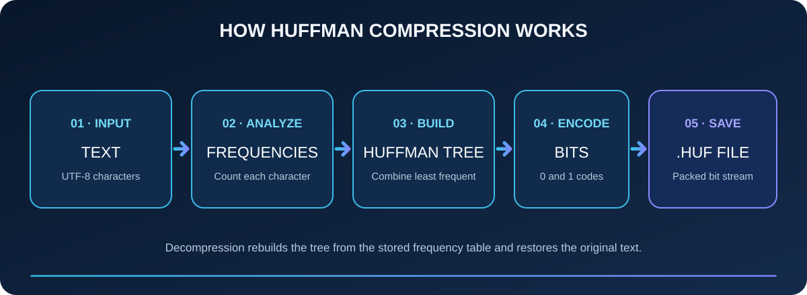
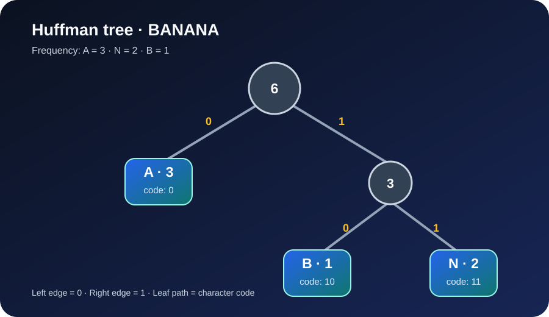

# Huffman Text Compressor

<p align="center">
  
</p>

<p align="center">
  <strong>A menu-driven Java application for lossless text compression using Huffman Coding.</strong>
</p>

<p align="center">
  
  
  
  
  
</p>

## Overview

Huffman Text Compressor demonstrates how variable-length, prefix-free codes can reduce the number of bits needed to represent text. The application supports interactive text encoding, file compression into a custom `.huf` archive, and file decompression.

## Concepts Used

| Concept | Where it appears | What it demonstrates |
|---|---|---|
| Huffman coding | Tree construction and encode/decode methods | Assigning shorter codes to more frequent characters |
| Greedy algorithm | `buildTree()` | Repeatedly combining the two lowest-frequency nodes |
| Binary tree | `Node`, `left`, `right` | Representing prefix codes as root-to-leaf paths |
| Priority queue | `PriorityQueue<Node>` | Efficiently selecting the lowest-priority nodes |
| Hash maps | Frequency and code maps | Counting characters and storing generated codes |
| Recursion | `generateCodes()` | Walking the tree to build each character's bit code |
| Prefix-free encoding | Huffman leaf nodes | Ensuring no character code is a prefix of another |
| Bit manipulation | `BitWriter`, `BitReader` | Packing and unpacking encoded bits in bytes |
| Binary file I/O | Data streams and `.huf` archive methods | Writing metadata and compressed bytes |
| UTF-8 text I/O | `StandardCharsets.UTF_8` | Reading and writing text files with an explicit charset |
| Validation and round-trip checks | Decode validation and regression tests | Detecting invalid data and checking that decoded text matches the input |

## Features

- **Text compression:** Enter text and inspect its Huffman bit sequence.
- **File compression:** Compress UTF-8 text files into a binary `.huf` file.
- **File decompression:** Restore text from a compatible `.huf` file.
- **Code inspection:** Display character frequencies and generated Huffman codes.
- **Round-trip verification:** Text mode displays the decoded result for comparison.
- **Deterministic tree ordering:** Frequency ties use the minimum character value as a tie-breaker.
- **Learning resources:** Concept guide, worked example, tree illustration, archive format notes, and complexity analysis.

## Visual workflow

<p align="center">
  
</p>

## Requirements

- JDK 11 or newer
- Terminal or Java IDE (IntelliJ IDEA, Eclipse, or VS Code with Java support)

## Quick start

### 1. Clone

```bash
git clone https://github.com/anuragchaurasiya/HUFFMAN-TEXT-COMPRESSOR.git
cd HUFFMAN-TEXT-COMPRESSOR
```

### 2. Compile

```bash
mkdir -p out
javac -encoding UTF-8 -d out src/HuffmanCompressor/HuffmanCompressor.java
```

### 3. Run

```bash
java -cp out HuffmanCompressor.HuffmanCompressor
```

## Menu

| Option | Description |
| --- | --- |
| 1 | Compress text entered in the console |
| 2 | Compress a UTF-8 text file into a `.huf` file |
| 3 | Decompress a `.huf` file into a text file |
| 4 | Display Huffman codes for entered text |
| 5 | Exit |

For file operations, enter the requested input and output paths. Keep the input and output paths different.

## Learn the concepts

The documentation includes a worked example using `BANANA`, a visual Huffman tree, an explanation of prefix-free codes, and the project's actual archive layout.

- [Huffman Coding Concepts](docs/HUFFMAN-CODING.md)
- [Algorithm and .huf File Format](docs/ALGORITHM.md)
- [Time and Space Complexity](docs/COMPLEXITY.md)

<p align="center">
  
</p>

## Run regression checks

The repository includes lightweight Java regression checks for frequency counting, encode/decode round trips, single-character input, and invalid encoded bits.

```bash
mkdir -p out
javac -encoding UTF-8 -d out \
  src/HuffmanCompressor/HuffmanCompressor.java \
  test/HuffmanCompressor/HuffmanCompressorTest.java
java -cp out HuffmanCompressor.HuffmanCompressorTest
```

GitHub Actions runs the build and regression checks on pushes and pull requests for Java 11, 17, and 21.

## Project structure

```text
HUFFMAN-TEXT-COMPRESSOR/
├── .github/
│   ├── ISSUE_TEMPLATE/
│   │   ├── bug_report.md
│   │   └── feature_request.md
│   ├── workflows/
│   │   └── java-ci.yml
│   └── PULL_REQUEST_TEMPLATE.md
├── assets/
│   ├── huffman-banner.svg
│   ├── huffman-workflow.svg
│   └── huffman-example-tree.svg
├── docs/
│   ├── ALGORITHM.md
│   ├── COMPLEXITY.md
│   └── HUFFMAN-CODING.md
├── src/
│   └── HuffmanCompressor/
│       └── HuffmanCompressor.java
├── test/
│   └── HuffmanCompressor/
│       └── HuffmanCompressorTest.java
├── .gitignore
├── CONTRIBUTING.md
└── README.md
```

## Current limitations

- Empty text and empty input files are not supported by the current file-compression flow.
- The implementation operates on Java `char` values (UTF-16 code units); it is not a Unicode code-point implementation.
- The `.huf` format is specific to this project and is not a standard archive format.
- Text-mode size reduction is an estimate based on 16 bits per Java character and excludes the code table and file metadata.
- A compression result may be larger for short or high-entropy input because the archive includes decoding metadata.

## Contributing

Bug reports, suggestions, and pull requests are welcome. Read [CONTRIBUTING.md](CONTRIBUTING.md) and use the repository issue templates when reporting problems or proposing improvements.

## License

No license has been selected yet. Until a license is added, do not assume the code is available for reuse under an open-source license.

---

<p align="center">
  Maintained by <a href="https://github.com/anuragchaurasiya">@anuragchaurasiya</a>
</p>