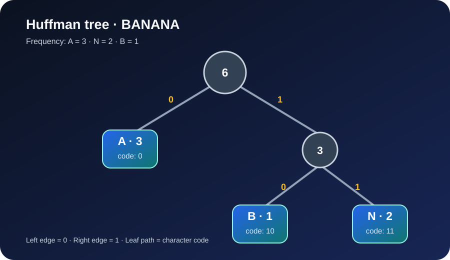

# Huffman Coding: Core Concepts

Huffman coding is a **lossless, variable-length, prefix-free coding** technique. It gives shorter bit codes to more frequent symbols and longer codes to less frequent symbols.

## The main ideas

### 1. Frequency table
Count how many times each character appears in the input. These counts guide the tree construction.

### 2. Greedy tree construction
Put one leaf node per distinct character into a min-priority queue. Repeatedly remove the two nodes with the smallest frequencies and join them under a new parent whose frequency is their sum. Insert the parent back into the queue. The final node is the root.

This is a greedy algorithm: at each step it combines the two least-frequent available nodes.

### 3. Prefix-free codes
Label every left edge `0` and every right edge `1`. A character's code is the path from the root to its leaf.

A code is prefix-free when no complete character code is the beginning of another character code. This means decoding can identify a character as soon as it reaches a leaf; separators are not needed.

### 4. Lossless decoding
The decoder follows bits from the root. Whenever it reaches a leaf, it writes that character and returns to the root. The original text is reconstructed exactly when the same tree and valid bit stream are used.

## Worked example: BANANA

The input `BANANA` has these frequencies:

| Character | Frequency |
| --- | ---: |
| A | 3 |
| N | 2 |
| B | 1 |

With this project's deterministic tie-breaking rule, the example tree produces:

| Character | Code |
| --- | --- |
| A | `0` |
| B | `10` |
| N | `11` |

So `BANANA` becomes:

`10 0 11 0 11 0` → `100110110`

Spaces above are only visual separators; the actual encoded bit sequence has no spaces.

  

## Why compression works

A fixed-width representation gives every symbol the same number of bits. Huffman coding instead uses the frequency distribution: common symbols receive shorter paths in the tree. The total encoded length is the sum of each character's frequency multiplied by its code length.

The archive also needs metadata (including the frequency table), so very small inputs may become larger after compression.

## Where this project uses the idea

- **Compress Text** builds a tree and prints the encoded bits.
- **Compress File** stores the frequency table and packed bit stream in a `.huf` file.
- **Decompress File** rebuilds the tree from the stored frequency table and restores the text.
- **Show Huffman Codes** displays the frequencies and codes without writing an archive.

For the exact binary archive fields, see [Algorithm and File Format](ALGORITHM.md).
